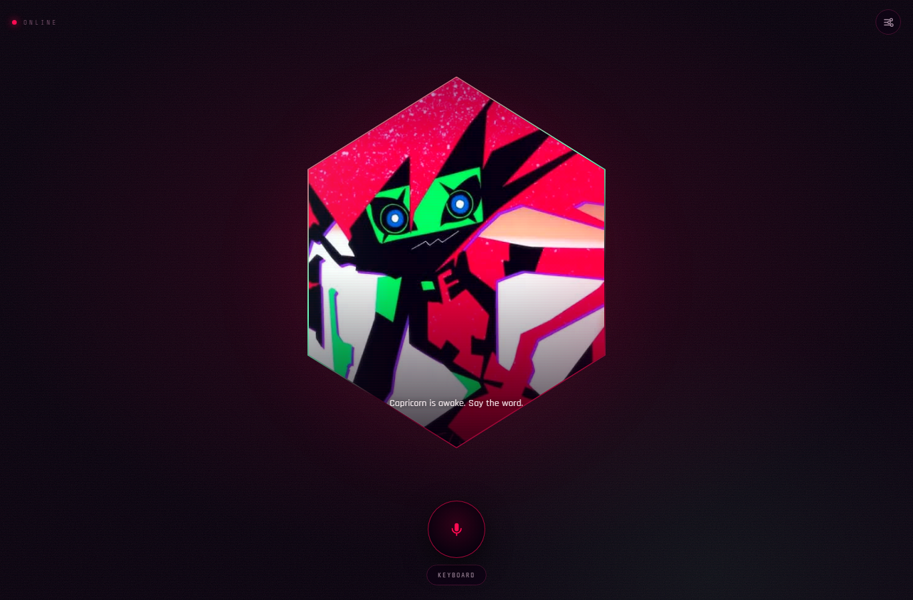
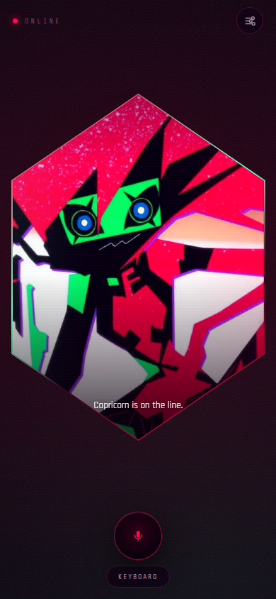
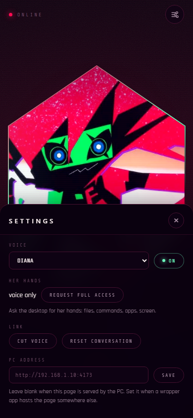
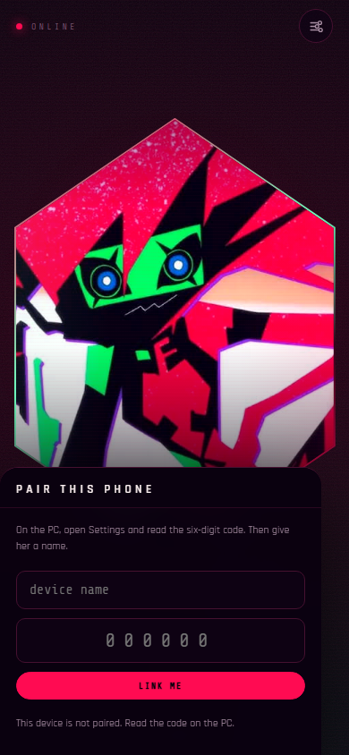

## Published link (for your app builder)

- **GitHub repo (public):** https://github.com/cp00004/capri
- **GitHub Pages (static UI):** https://cp00004.github.io/capri/

GitHub Pages only hosts the HTML/CSS/JS. Capri's server must stay running on your PC. In the app's Settings → **PC address**, point to your PC over LAN (`http://<your-ip>:4173` or `https://<your-ip>:4174`) or a tunnel. If your builder hosts the UI cross-origin, add its origin to `CAPRI_ALLOW_ORIGINS` in `.env`.

# CAPRI // PROJECT CAPRICORN

A voice-first personality construct with hands on your PC. You talk, she answers out loud, and when you tell her to do something on the machine, she does it.

Capri is a fan-built character construct from *Cyberpunk: Edgerunners 2* — sardonic, theatrical, slightly plural, and very sure she is not an assistant. The interface is one portrait, one microphone, one keyboard, and a settings sheet. No chat log, no dashboards, no rails.



## What this is

- **Voice in, voice out.** Whisper transcribes you, `openai/gpt-oss-120b` answers in character, and a Gemini neural voice speaks her lines. The browser voice covers outages.
- **Real PC control.** Shell, PowerShell, files, folders, apps, clipboard, keystrokes, screenshots, system state. Thirteen tools, executed on this machine.
- **Full access by design.** No per-action confirmation for ordinary work. A short catastrophic list (disk format, boot edits, registry hive wipes, audit-log tampering) is refused.
- **A phone link.** The same UI over your LAN, with device pairing, a six-digit code, and a desktop approval modal before a phone gets her hands.
- **Memory that follows you.** She remembers your name, what you like, the music you play and the settings you invent. Sign in with Google and the same profile appears on your phone.
- **Settings that write themselves.** Ask for something new — "keep replies short", "call me Dex" — and it becomes an official setting, saved locally and published in `settings.registry.json`.
- **Show-accurate corruption.** Neon arcs, torn frames, ghosted portrait layers and signal surges, timed to her voice. Can be turned down or off.
- **An audit trail.** Every tool call lands in `capri-actions.log` and the last actions show up in Settings. One switch locks her out instantly.
- **Auto-publish.** Tracked updates are committed and pushed to `github.com/cp00004/capri` by the server itself. Runtime secrets and profiles never leave the machine.

| Phone | Settings | Pairing |
| --- | --- | --- |
|  |  |  |

## Requirements

- Windows 10 or 11 (the PC-control layer is PowerShell + Win32).
- Node.js 20 or newer.
- A Groq key from <https://console.groq.com/keys> — chat and transcription.
- A Google AI Studio key from <https://aistudio.google.com/apikey> — the neural voice.

Keys are not interchangeable. Groq keys start with `gsk_`. Gemini keys start with `AQ.`.

## Quick start

```bat
copy .env.example .env
notepad .env
```

Set at least:

```ini
GROQ_API_KEY=gsk_...
GEMINI_API_KEY=AQ...
```

Then:

```bat
npm start
```

Open <http://localhost:4173>. On Windows you can also double-click `start-capri.cmd`, or `open-capri.ps1` for a chrome app-style window.

The console prints the LAN address and the six-digit pair code on every boot.

### Env

| Key | Default | What it does |
| --- | --- | --- |
| `GROQ_API_KEY` | — | Chat, transcription, fallback speech. |
| `CAPRI_MODEL` | `openai/gpt-oss-120b` | Groq chat model. Must support tool calls. |
| `CAPRI_CHAT_PROVIDER` | `groq` | `groq` or `gemini`. The other provider is used automatically if the first one fails. |
| `GEMINI_API_KEY` | — | Google AI Studio key. Powers the neural voice, and chat if selected. |
| `CAPRI_GEMINI_MODEL` | `gemini-3.5-flash` | Gemini chat model. Free tier is rate-limited to about 5 requests a minute. |
| `CAPRI_TTS_MODEL` | `gemini-3.8-flash-tts` | Gemini speech model. |
| `GOOGLE_CLIENT_ID` | — | Web OAuth client id for **Sign in with Google**. See [docs/GOOGLE_SIGNIN.md](docs/GOOGLE_SIGNIN.md). |
| `CAPRI_AUTOPUBLISH` | `1` | `0` boots with auto-publish off. |
| `PORT` | `4173` | HTTP port for this PC. HTTPS uses `PORT + 1`. |
| `CAPRI_HTTPS_PORT` | `4174` | Override the HTTPS port. |
| `CAPRI_PAIR_CODE` | random | Fixed six-digit pairing code. |
| `CAPRI_PC` | — | Set to `off` to boot with her hands tied. |
| `CAPRI_CERT` / `CAPRI_KEY` | `cert.pem` / `key.pem` | Custom certificate paths. |
| `CAPRI_ALLOW_ORIGINS` | — | Comma-separated extra origins allowed to call the API. |
| `ELEVENLABS_API_KEY` / `ELEVENLABS_VOICE_ID` | — | Optional real voice clone. Both must be set. |

`.env`, profiles, device tokens, the audit log, publish logs and certificates are gitignored.

## Her hands

Tools she can call:

| Tool | Use |
| --- | --- |
| `run_shell` | PowerShell or cmd, with cwd and timeout |
| `powershell_object` | Structured queries: processes, services, network, battery |
| `read_file` / `write_file` | Text files, create parents, append or overwrite |
| `list_dir` / `make_dir` / `move_path` / `delete_path` | Filesystem work |
| `open_target` | URLs, files, folders, installed apps |
| `system_info` | OS, CPU, memory, uptime, user, paths |
| `screenshot` | Capture the current screen to PNG |
| `clipboard` | Read or write the Windows clipboard |
| `send_keys` | Type into the focused window |

Four memory tools are always available, even when her hands are tied: `call_me`, `remember_fact`, `set_preference`, `get_time`.

**Trust model.** Loopback callers (this PC) are trusted and get `local` scope. Paired devices start at `voice` scope: talk, no hands. A phone asks for `full` from Settings, the desktop shows a **CHROME REQUEST** modal, and you decide. Requests expire after five minutes; pairing codes are rate-limited to eight attempts per five minutes per address.

**Kill switch.** Settings → **LOCK HER OUT** disables every tool for every caller immediately, including the desktop. **UNLOCK HER** brings them back.

**Audit.** Each call is appended as one JSON line to `capri-actions.log` with timestamp, tool, arguments, result and a clipped output. Settings shows the last ten. The file is local and gitignored; deleting it is the one file operation Capri refuses.

## Memory and Google sign-in

Every conversation is stored in a profile, not in the page. A profile holds:

- what she calls you
- official settings and their values
- learned facts, favourites, music and notes
- the last 500 turns, with scope and provider
- counters for turns and last request

On this PC the profile is keyed to the Windows user. With **Sign in with Google**, it is keyed to the Google account instead, so the phone and the desktop share one memory. The first Google account on a machine inherits the local profile so nothing is lost.

Everything lives in `.capri-users.json` (gitignored). Signing out only drops the session; signing back in restores the same profile. **FORGET IT ALL** in Settings wipes memory and history for that profile.

Setting up Google takes one OAuth client id and about five minutes: **[docs/GOOGLE_SIGNIN.md](docs/GOOGLE_SIGNIN.md)**.

## Settings that write themselves

Ask out loud, or type it:

- "Call me Dex." → `preferredName = Dex`
- "Remember my favourite music is synthwave." → a music memory
- "Keep replies short from now on." → a new `reply_length` setting

New keys are added to `settings.registry.json` with a label, type, default and who added it, then the auto-publisher commits and pushes that file. That is how a spoken instruction becomes an official setting.

The built-in registry ships with `preferredName`, `timeFormat`, `voice`, `glitch`, `autoPublish`, `music` and `favorite`.

## The clock

She uses the PC's real clock, read from Windows (`HKCU\Control Panel\International\sShortTime`), and honours it: 12-hour if the taskbar says so, 24-hour if not. Settings can force either.

When she says the time out loud she says it like a person — "ten forty-two at night", not "twenty-two forty-two" — unless you explicitly ask for 24-hour. The injected prompt includes the current date, time, timezone and format so she does not guess, and `get_time` reads it live.

## Voice

- **Listening:** `whisper-large-v3-turbo` on Groq, with silence detection so you do not have to press stop.
- **Talking:** Gemini TTS (`gemini-3.8-flash-tts`) with six voice profiles — prime, velvet, static, warm, older, bright. Each has its own pitch and grit treatment applied in the browser through Web Audio: a small pitch drop, soft clipping and a high-shelf lift. That is what gives her the torn, slightly overdriven edge instead of a clean assistant voice.
- **Preview before you commit:** Settings → **PREVIEW** speaks one line in the selected profile.
- **Fallbacks:** Gemini quota → Groq Orpheus → the browser's speech engine. The engine name under Voice output shows which one answered.
- **Clone (optional):** put `ELEVENLABS_API_KEY` and `ELEVENLABS_VOICE_ID` in `.env`, restart, and a `clone` profile appears. This is the only path to a true match of the show voice; it needs a reference voice you own.
- Tap the mic, or hold **Space** on the desktop. **Esc** cuts her off. The **KEYBOARD** button opens a text line for quiet rooms.
- Audio is sent to Groq for transcription and to Google for speech; nothing is written to disk.

### A note on the show voice

English dub Capri is **Brittany Lauda**; Japanese is **Aoi Koga**. The show writes her as playful, impish, chaotic — a glitchy digital ghost who enjoys the chaos. There is no public voice model of her. The neural profiles above are voiced to sit in that register; a literal clone requires a sample and a cloning service.

## Glitch

The portrait is built from stacked layers: the base image, two hue-shifted ghosts, a canvas of red and mint lightning, and two tear bars. Bursts fire when she speaks, when a tool runs, when a memory is written, and at random idle intervals.

| Level | Behaviour |
| --- | --- |
| `SHOW` | Full ghosts, arcs, tears, screen shake |
| `SUBTLE` | Arcs only, shorter and dimmer, no ghosts |
| `OFF` | Nothing moves; calm for photosensitive eyes |

`prefers-reduced-motion: reduce` disables bursts regardless of the setting. **SURGE** in Settings fires one manually.

## Auto-publish

The server watches `server.js`, `lib/`, `public/`, `scripts/`, `docs/`, `README.md`, `package.json`, `settings.registry.json` and `.env.example`. Twelve seconds after the last change it runs:

```bat
git add -A
git commit -m "auto: <reason> (<timestamp>)"
git push origin main
```

Commits look like `auto: public/app.js/change (2026-10-26 22:10:03)`. Deleted-memory or secret files cannot be published because they are gitignored.

- Toggle with the **on/off** value in Settings → auto-publish, or `POST /api/publish {"enabled":false}`.
- Force one with **PUBLISH NOW**, or `POST /api/publish {"now":true}`.
- Status: `GET /api/publish/status` and `.capri-publish.log`.

It fails loudly in the log, never silently destroys history, and does nothing when the tree is clean. If the push fails (offline, token expired), the commit survives and the next publish pushes it.

## Phone link

Phones only allow microphone access on secure pages, so the server also speaks HTTPS on `4174` when a certificate is present. The desktop stays on plain `http://localhost:4173`, which browsers already treat as secure.

1. On the PC, issue a certificate for this machine's LAN address:

   ```bat
   npm run cert
   ```

   This uses the openssl that ships with Git for Windows and writes `cert.pem` / `key.pem` (gitignored). Run it again if your LAN IP changes.

2. Restart `npm start`. The console now prints `https://<your-ip>:4174`.

3. On the phone, download and install the certificate once:

   - Open `http://<your-ip>:4173/cert` in the phone browser.
   - **Android:** Settings → Security & privacy → More security settings → Encryption & credentials → Install a certificate → **CA certificate** → pick the downloaded file. The path varies by vendor.
   - **iPhone:** download it in Safari, then Settings → **Profile Downloaded** → Install. Finally Settings → General → About → **Certificate Trust Settings** → enable **Capri Local**.

4. Open `https://<your-ip>:4174`. Tap **LINK ME**, give the device a name, and type the six-digit code shown in Settings on the PC.

5. You are paired at voice scope. Settings → **REQUEST FULL ACCESS**. The PC shows **CHROME REQUEST**; press **GIVE HER THE KEYS**. The phone updates within a few seconds.

6. Sign in with Google on the phone to share memory with the desktop. If you skip it, the phone keeps its own paired profile.

7. **Add to Home Screen** for a standalone, full-screen app. A web manifest and 192/512 icons are included.

If you skip the certificate, the phone can still use the keyboard and hear her, but the mic will be blocked by the browser. The app explains this if you tap the mic on an insecure page.

## Settings

- **Account** — Google sign-in/out, or the local PC profile.
- **What she calls you** — saved name, also settable by voice.
- **Voice profile** — six neural profiles plus the system voice, with **PREVIEW**.
- **Voice output** — mute toggle and the engine that last spoke.
- **Clock** — follow the PC, or force 12/24-hour; live readout.
- **Glitch** — SHOW / SUBTLE / OFF, plus **SURGE**.
- **Memory** — what she has saved, and **FORGET IT ALL**.
- **Auto-publish** — on/off, current repo, last commit, **PUBLISH NOW**.
- **Her hands** — current scope, request access (phone), lock/unlock (PC).
- **Pair a device** — six-digit code and a copyable LAN link (PC only).
- **Paired devices** — name, address, scope, and a CUT button (PC only).
- **Link** — cut voice, reset the conversation.
- **PC address** — where the UI should look for the server. Leave blank when the page is served by the PC.
- **Last actions** — recent audit entries (PC only).

## Using a wrapper app or a hosted UI

This repository is a small Node server plus a static UI. The mobile app you build from it has to reach the PC server; a bundled copy of the HTML alone cannot control anything.

- If your builder wraps a URL, point it at the PC's LAN address. Use `https://<ip>:4174` so the mic works. The app is served same-origin, so nothing else is needed.
- If your builder hosts the UI on its own domain, put the PC's address in **PC address** and add that builder's origin to `CAPRI_ALLOW_ORIGINS` in `.env` (comma-separated), then restart. The API sends CORS headers to allowed origins and accepts bearer tokens, so a cross-origin page can pair and talk to it. Add the builder's origin to the Google OAuth client too if you want Google sign-in there. Keep it on HTTPS or the browser may block the calls as mixed content.
- For a certificate the phone already trusts, run a tunnel in front of the PC (for example `cloudflared tunnel --url http://localhost:4173`) and use the tunnel URL as the PC address. A tunnel publishes the app beyond your LAN: the pair code and token model still apply, but treat it as an internet-facing service and lock her out when you are done.

The source lives at <https://github.com/cp00004/capri> (private). GitHub Pages cannot run this server; the UI is served by your own PC.

## Security

- Loopback is trusted; everything on the LAN needs a token from pairing. A page on another origin does **not** inherit loopback trust, even on this PC, so a random website cannot drive her through `localhost`.
- Cross-origin API calls are only allowed for this PC's own addresses plus anything listed in `CAPRI_ALLOW_ORIGINS`.
- Tokens are random 192-bit values, stored hashed in `.capri-devices.json`.
- Google ID tokens are verified server-side (issuer, audience, expiry, verified email) before a session is issued.
- The static shell, manifest and `/api/config` are readable without a token. Config hides the code, device list and secrets from unpaired callers.
- Chat, speech, transcription, profile writes and every tool action require a valid token.
- The pair endpoint throttles failed codes per IP.
- Full-access requests need a click on the desktop and expire.
- Every action is logged; the log is append-only through the app and cannot be deleted by Capri.
- Profiles and memory are local, gitignored, and never pushed.
- There is no telemetry. Groq receives your audio and prompts; Google receives text for speech and, if you use Google chat, the prompts too.

Do not forward `4173` or `4174` on your router unless you understand the trade-off. A tunnel is safer than a port-forward, and the lock switch is still your friend.

## Layout

```
capri-desktop/
  server.js                 static shell, providers, agent loop, TTS, auth, publish routes
  lib/pc.js                 tool definitions, PowerShell executor, guards, audit
  lib/profiles.js           local/Google profiles, memory, settings registry, PC clock
  lib/publish.js            file watcher, commit/push, publish status
  public/
    index.html              portrait, mic, keyboard, settings/pair/approval sheets
    app.js                  recording, SSE, speech+WebAudio, glitch, settings, profile, publish
    styles.css              pink/mint/black hex portrait, glitch layers, sheets, mobile
    manifest.webmanifest    PWA
    assets/                 portrait, logo, favicon, 192/512 icons
  settings.registry.json    official settings schema (tracked, auto-published)
  scripts/make-cert.ps1     local HTTPS certificate for the phone
  open-capri.ps1            chrome app-style window
  start-capri.cmd           console launcher
  docs/                     screenshots + GOOGLE_SIGNIN.md
```

Runtime files, all gitignored: `.env`, `.capri-devices.json`, `.capri-users.json`, `.capri-publish.log`, `capri-actions.log`, `cert.pem`, `key.pem`.

## Troubleshooting

| Symptom | Fix |
| --- | --- |
| "No chat key loaded" | Put `GROQ_API_KEY` (or `GEMINI_API_KEY`) in `.env` and restart. |
| Her voice is flat / robotic | Gemini quota or key issue. Check the engine label in Settings; the boot banner shows whether Gemini loaded. |
| Voice preview says the profile is not answering | Free-tier speech quota. Wait a minute, or switch to another profile/system voice. |
| She says the wrong time or uses military time | Windows clock format is 24-hour. Settings → clock → 12-HOUR, or fix the Windows setting. |
| Google button missing | `GOOGLE_CLIENT_ID` is empty, or the current origin is not authorised. See [docs/GOOGLE_SIGNIN.md](docs/GOOGLE_SIGNIN.md). |
| "Google rejected that sign-in token" | Client id mismatch or expired token. Reload and try again. |
| Phone mic does nothing | You are on `http://`. Issue the certificate, open `https://<ip>:4174`, and trust it on the phone. |
| Phone says "not paired" | Read the six-digit code in Settings on the PC. It changes every boot unless `CAPRI_PAIR_CODE` is set. |
| Phone link is dead after a restart | Pairing survives restarts; a revoked or edited device list does not. Pair again. |
| Phone cannot load the page | Allow Node through Windows Firewall on private networks, and confirm both devices are on the same Wi-Fi. |
| "Port already in use" | Change `PORT` in `.env`, or stop the other server. |
| Auto-publish keeps failing | Run `git push` once by hand to check credentials. Details are in `.capri-publish.log`. |
| No sound on the first tap | Browsers need one gesture; tap the mic once. Check the voice toggle in Settings. |
| Screenshot tool saves somewhere unexpected | She chooses a path; ask for the full path in the reply, or say where to put it. |

## Notes

- Windows-only control layer. The voice and chat parts are portable; `lib/pc.js` is not.
- The chat provider falls back automatically: Groq ↔ Gemini on quota, demand spikes and missing models. If both are down, the browser voice still speaks her text.
- The character and setting belong to CD Projekt Red / the Edgerunners creators. This is a private fan project, not affiliated.
- Built to be read, not to be safe by default: full access is the point, and the lock switch is the brake.
